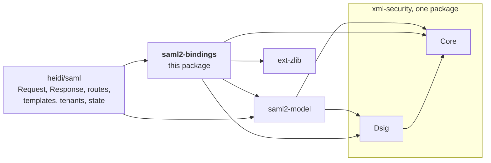

# saml2-bindings: specification

The two browser bindings of the SAML 2.0 stack, HTTP-Redirect and HTTP-POST, between the strings HTTP carries and the documents `saml2-model` reads and writes: a query string or a form's fields decoded into a `Document`, the detached signature of HTTP-Redirect verified over the octets the sender signed and nothing else, and a message the model wrote turned into a URL or a form. It knows no HTTP object, reads no SAML element, and hands the model nothing it has not authenticated as the binding says.

| | |
|---|---|
| Repository | `beffroi-php/saml2-bindings` |
| Package | `beffroi-php/saml2-bindings` |
| Namespace | `Beffroi\Saml2\Bindings`, next to `Beffroi\Saml2\Model` of `saml2-model` |
| Runtime | PHP 8.4 or later, `ext-zlib`; `beffroi-php/saml2-model`, its public classes (section 6.5); `beffroi-php/xml-security`, the public classes of its `Core` and `Dsig` namespaces (section 6.6). Nothing else. |
| Consumers | `heidi/saml`, the module of the identity provider's monorepo, in both roles; outside the project, any identity provider or service provider written in PHP on `saml2-model` |
| Design | Sub-spike 9b of [spike 9](https://github.com/Spomky-Labs/heidi-design/blob/main/spikes/09-saml/README.md), second half; [decision 0013](https://github.com/Spomky-Labs/heidi-design/blob/main/docs/decisions/0013-saml-formats-xml-ecrits-ici.md) (the stack writes its SAML formats; the HTTP-Redirect signature covers `SAMLRequest`, `RelayState` and `SigAlg` in that order and that order only, under a `SigAlg` of the closed list), [decision 0015](https://github.com/Spomky-Labs/heidi-design/blob/main/docs/decisions/0015-xml-security-un-seul-paquet.md) (one package for XML security, SAML apart), [decision 0006](https://github.com/Spomky-Labs/heidi-design/blob/main/docs/decisions/0006-sur-par-defaut.md) (no option to do it wrong), [decision 0007](https://github.com/Spomky-Labs/heidi-design/blob/main/docs/decisions/0007-bibliotheque-et-bundle-des-le-premier-commit.md) (the bundle keeps HttpFoundation) of the identity provider's design repository |

This document states what the package does, what it refuses and what it guarantees; the code conforms to it, or the document changes first, in its own commit, with its reason. Section 4 lists the invariants every test enforces, each with the attack class it closes, section 5 the public API, section 6 the order of the rules in each direction, section 9 the corpus that judges the package. The specification of `saml2-model` is cited as `model.md`, its invariants as `M-n`; those of `xml-security` as `core.md` and `dsig.md`, their invariants as `I-n` and `D-n`; the invariants of this document are `B-n`. A change that this package needs in `saml2-model` or `xml-security` is an issue on their repository, opened with the maintainer's agreement, never a workaround here.

## 1. Why this package exists

`saml2-model` knows no HTTP (decision 0013): it reads a `Document` and writes one. Between the browser and the model, a message crosses a URL or a form, and each crossing has failures of its own that the model cannot see, since by the time it holds a document they have already happened.

1. **The signed message is not the processed message.** The signature of HTTP-Redirect is detached: it covers a string built from parameters of the query string, not the XML. A receiver that builds that string from one parameter and decodes another verifies one message and processes another. CVE-2025-27773 (simplesamlphp/saml2 before 4.17.0, March 2025, CVSS 8.6) is exactly this: with `SAMLRequest` and `SAMLResponse` both in the query string, the signed string took the last of the two and the receiver took `SAMLRequest` in priority, so that any message the peer had signed made an unsigned one accepted. Duplicate parameters are the same class: PHP's `$_GET` keeps the last of two parameters of one name, and a second parser of the same string may keep the first.
2. **The signed octets are rebuilt instead of read.** URL-encoding is not canonical: one value has several encodings. SAML Bindings §3.4.4.1 fixes the octets to verify, `SAMLRequest` or `SAMLResponse`, then `RelayState`, then `SigAlg`, "whatever the actual order may be in the query string", and requires the relying party to "perform the verification step using the original URL-encoded values it received". A receiver that re-encodes the decoded values, or takes the parameters in the order they arrived, verifies a string the sender did not sign: it refuses genuine messages, and it lets the sender's choices into what is verified.
3. **The algorithm is the sender's word.** `SigAlg` is a parameter of the request, and Bindings §3.4.4.1 requires every implementation to support RSA with SHA-1 and DSA with SHA-1. A receiver that verifies under the algorithm the request names verifies under SHA-1, or maps an unknown URI to a default.
4. **The binding's authentication is taken on trust.** The model offers `validateAuthenticatedByBinding()` for a message whose signature the binding verified (model.md §5.6), and it takes the caller's word for it. A consumer that calls it for a query string nobody verified accepts an unauthenticated logout. This package is the one caller that can make the word true.
5. **The decoder is the attack surface.** DEFLATE expands up to 1 032 times, a length of 258 bytes coded in two bits (RFC 1951): the few kilobytes of a URL into megabytes, a megabyte into a gigabyte; base64 and percent-encoding have several spellings for one value (unused bits set, `+` for a space, lowercase hexadecimal); a zlib or gzip wrapper, a truncated stream or bytes after its end are what one decoder accepts and another refuses. Two decoders that disagree on one input are a parser differential, the class that broke ruby-saml in 2025.
6. **`RelayState` is state an attacker carries.** It travels through the browser, signed over HTTP-Redirect only when the message is, never over HTTP-POST. Bindings §3.4.3 and §3.5.3 bound it to 80 bytes and leave its integrity to whoever created it. A binding that interprets it, or hands it to the model, gives the attacker a channel into the protocol.

The package answers each with a rule in code. No rule has an option that turns it off (decision 0006); a bound can be raised up to a ceiling for a documented reason, never removed.

## 2. Position



The package reaches XML through `Core` only: the consumer's `Loader` loads what it decoded, `Serializer` serializes what a writer built, and `Children::optional()` looks for one node, a `ds:Signature` among the children of a received root (B-6). It signs and verifies the detached signature through `Dsig` only: `SigningKeyInterface::sign()`, `Verifier::verifyDetached()`, `SignatureAlgorithm::fromUri()`. It reads and writes SAML through the public classes of `saml2-model` only (section 6.5). It calls no `openssl_*` function and builds no DOM.

It knows no HTTP object (decisions 0007, 0013): no `Request`, no PSR-7 message, no superglobal, no header, no cookie, no session, no HTML. It takes the raw query string and the parsed fields of a form as the consumer received them, and gives back a URL, or a form's action and fields. It knows no time, no tenant and no state: the requests sent, the `RelayState` issued, the peer a message comes from and the URL at which it arrived are the consumer's (section 6.8).

It reads no SAML element. Which message it expects is the method the consumer calls, which the endpoint decides: an `AuthnRequest` at a single sign-on service, a logout message at a single logout service, a response at an assertion consumer service; the model's `Unverified*::of()` checks the root. On the way out it takes the model's message objects and calls the model's writer itself: the URL it sends to is the message's `Destination`, which the writer requires, and a message it sends over HTTP-Redirect is unsigned in XML because it asked the writer for no signature.

## 3. Threat model

Each row is an attack class, the rule that answers it, and where the rule lives. The invariants are numbered in section 4; the corpus cases in section 9.

| Threat | Incident or source | Rule | Where |
|---|---|---|---|
| Signature confusion: the parameter signed and the parameter processed differ | CVE-2025-27773 (GHSA-46r4-f8gj-xg56) | Exactly one message parameter; the bytes decoded are the raw value the signed octets hold | B-1, B-2, `RedirectReceiver` |
| Parameter pollution, two parsers of one query string | PHP's `$_GET` keeps the last duplicate | Each parameter the binding reads at most once, under its literal name | B-1 |
| Octets rebuilt, re-encoded, or taken in the order of arrival | Bindings §3.4.4.1 | The raw substrings as received, in the binding's order, whatever the order of arrival | B-2, `Internal\SignedOctets` |
| Algorithm downgrade or confusion | Bindings §3.4.4.1 requires RSA-SHA1 and DSA-SHA1 | `SigAlg` through D-5's closed list, `Signature` and `SigAlg` both or neither, checked before the message is decoded | B-3 |
| Key substitution | A key named or carried by the request | The keys of the peer's metadata, `verificationKeys()`; nothing in the query string names a key | B-4, M-3, D-7 |
| A message authenticated by the caller's word | model.md §5.6, `validateAuthenticatedByBinding()` | Called by this package only, and only after `verifyDetached()` held over the octets of B-2 | B-5 |
| An XML signature where the binding removed it | Bindings §3.4.4.1 step 1 | Refused on reception; never written on emission | B-6 |
| Decompression bomb, oversized input | DEFLATE expands about a thousandfold | Every input bounded before it is decoded; inflation bounded while it runs | B-7 |
| Encoding differentials | Non-canonical base64, percent-encoding variants, a zlib or gzip wrapper, a truncated stream, trailing bytes | One lexical form per value | B-8 |
| `RelayState` as a channel into the protocol | Bindings §3.4.3, §3.5.3, erratum E1 | Opaque, at most 80 bytes, returned, never given to the model; covered by the signature over HTTP-Redirect | B-9 |
| A document re-serialized between what arrived and what is read | core.md I-15 | The decoded bytes loaded as they are; what is sent serialized once | B-10 |
| An identifier or a value in the logs | Core §8.3.7 | Refusals name the rule and carry no value | B-11 |
| Sending what the peer must refuse | Profiles §4.1.2, §4.4.4.1, §4.4.4.2 | No response over HTTP-Redirect; every logout message signed | B-12 |
| An HTTP object or a second parser of the request inside the brick | Decisions 0007, 0013 | Strings and arrays in, strings and value objects out | B-13 |

## 4. Invariants

Each invariant is code, never a constructor option or a flag, has at least one test in the corpus of section 9, and names the attack class it closes.

- **B-1. One message, named once.** A query string or a form carries exactly one of `SAMLRequest` and `SAMLResponse`: both, or neither, is refused before anything is decoded. In a query string, each of the six parameters the binding reads, `SAMLRequest`, `SAMLResponse`, `RelayState`, `SigAlg`, `Signature` and `SAMLEncoding`, appears at most once, under its literal name: a second one, or a percent-encoded spelling of one of the six (`SAML%52equest`), which PHP's parser would decode to the name and this package would not, is refused. In a form, whose fields the consumer's parser already decoded (section 6.8), each of the three it reads is a string, never an array. The message the package decodes is the raw value the signed octets hold (B-2), never another occurrence. Signature confusion (CVE-2025-27773), parameter pollution.
- **B-2. The octets verified are the octets received, in the binding's order.** Over HTTP-Redirect, the octets the signature covers are `SAMLRequest=` or `SAMLResponse=` and its value, then `&RelayState=` and its value when the parameter is present, then `&SigAlg=` and its value, each value the substring of the query string exactly as it arrived, still percent-encoded, in that order whatever the order in which the parameters arrived, and nothing else (Bindings §3.4.4.1, steps 2 and 3 of the signature and the note that follows them). Nothing is decoded and encoded again to build them. On emission, the octets are built the same way from the values the package encoded, and the URL carries them in that order, then `Signature`. Re-encoding, order confusion.
- **B-3. `Signature` and `SigAlg` together, `SigAlg` on the closed list.** A `Signature` without `SigAlg`, or a `SigAlg` without `Signature`, is refused. `SigAlg` is read with `SignatureAlgorithm::fromUri()` (D-5): RSA with SHA-256, SHA-384 or SHA-512, and their RSASSA-PSS forms where the build has them; RSA with SHA-1, DSA, ECDSA, HMAC and every other URI are refused before the message is decoded or inflated. Bindings §3.4.4.1 requires RSA-SHA1 and DSA-SHA1 of every implementation; this package refuses both (decision 0013, section 8). It signs under the algorithm of the consumer's `Signing`, RSA-SHA256 by default. Algorithm downgrade and confusion.
- **B-4. Keys from the peer's metadata.** A detached signature is verified by `Verifier::verifyDetached()` with the keys that `verificationKeys()` of the peer's role returns, the peer the consumer chose with the unverified `Issuer` (M-1, M-3); nothing in the query string names or carries a key, and the verifier tries every key of the role (D-7). A signed message from a peer whose role has no signing certificate is refused (`NoVerificationKey`). Key substitution.
- **B-5. The binding's authentication is the binding's word.** This package calls `validateAuthenticatedByBinding()` of the model's validators, and only after `verifyDetached()` returned a key for the octets of B-2 under the keys of B-4, those octets holding the very value the document was decoded from: the message and the octets of its signature come out of one decoding of one input, whoever builds the received message (section 5.2). A message received over HTTP-Redirect without `Signature` goes to the validator's `validate()`, which refuses what M-2 requires to be signed: every logout message, and an `AuthnRequest` either party's metadata wants signed. A message received over HTTP-POST goes to `validate()`, which verifies its XML signatures. The consumer never calls `validateAuthenticatedByBinding()` itself (section 6.8). A message authenticated by the caller's word.
- **B-6. No XML signature over HTTP-Redirect.** A message received over HTTP-Redirect whose root holds a `ds:Signature` child is refused, whether the query string is signed or not: the binding removes the XML signature before encoding (Bindings §3.4.4.1 step 1), and SAML puts it nowhere else on a protocol message (Core §5.4.1). A message the package sends over HTTP-Redirect is written by the model's writer, called by the package with no `Signing`, so it carries none. An XML signature that the binding never verifies and a reader might.
- **B-7. Bounded before it is produced.** The raw query string, each form value and the text of `Signature` are bounded before anything decodes them; the inflated message is bounded while inflation runs: its output is refused as soon as it would exceed `maxInflatedBytes`, never measured once it is whole (section 7). Decompression bomb, denial of service.
- **B-8. One lexical form per value.** Percent-encoding: a `%` is followed by two hexadecimal digits, of either case, or the value is refused, and a `+` is a space, as the `application/x-www-form-urlencoded` encoding of the URL Standard says, which a browser writes and PHP's own parser of a query string applies (section 13). Base64: the alphabet of RFC 4648 §4 with its padding and its unused bits zero, so that the decoded bytes encode back to the same text (RFC 4648 §3.5); the URL-safe alphabet, a missing or an extra `=`, a set unused bit, are refused; over HTTP-Redirect no whitespace at all (Bindings §3.4.4.1 step 3 and signature step 4), so that a `+` sent unescaped, decoded to a space, is refused; over HTTP-POST carriage returns and line feeds only, the line breaks of RFC 2045 §6.8, removed before decoding, and any other whitespace refused. DEFLATE: raw (RFC 1951, Bindings §3.4.4.1 step 2), neither the zlib (RFC 1950) nor the gzip (RFC 1952) wrapper, the stream complete, nothing after its final block. Parser differentials.
- **B-9. `RelayState` is opaque, bounded and returned.** At most 80 bytes once decoded (Bindings §3.4.3, §3.5.3), not empty (section 12), never parsed or interpreted, never given to the model, returned to the consumer as decoded; over HTTP-Redirect, when present, it is in the octets the signature covers (B-2, erratum E1). On emission the same bounds hold, a programming error of the caller otherwise (`\InvalidArgumentException`). Its integrity, its meaning and its echo in the answer are the consumer's (section 6.8). A channel into the protocol.
- **B-10. What is read is what arrived; what is sent is serialized once.** The bytes that base64 and DEFLATE give back are loaded by the consumer's `Loader`, `SamlLoader::create()` (M-14), as they are: nothing trimmed, re-encoded or normalised, and no received document is ever serialized again (core.md I-15). What the package sends is the `Document` the model's writer returned, serialized once by `Core`'s `Serializer`, then deflated or not, then base64-encoded. Re-serialization differentials.
- **B-11. Refusals name the rule, never the input.** An exception says which invariant or which section refused, and never carries a parameter's name as received, a value, a `RelayState`, a URL, a query string, an entity ID or any byte of a message (Core §8.3.7; M-16, I-16 and D-13 hold the same line around it). Leaks through logs.
- **B-12. Only what the profiles let travel.** Over HTTP-Redirect, the package sends and receives an `AuthnRequest`, a `LogoutRequest` and a `LogoutResponse`, and never a `Response` (Profiles §4.1.2: the HTTP-Redirect binding must not carry the response); no method exists for it. A logout message is always signed when this package sends it, its query string over HTTP-Redirect and its XML over HTTP-POST (Profiles §4.4.4.1, §4.4.4.2): the methods that send one take a `Signing`, never `null`. Sending what the peer must refuse.
- **B-13. Strings and arrays, no HTTP object.** The package takes the raw query string and the form's fields and returns a URL, or a form's action and fields; no class of HttpFoundation, PSR-7 or any HTTP library, no superglobal, no header and no HTML is in it, which Deptrac and the rules of section 8 hold. The bundle keeps HttpFoundation (decisions 0007, 0013), and a test of the package needs nothing but strings.

## 5. Public API

Everything below is `final`. Value objects are `readonly` with public properties. Every method that refuses input declares what it throws (section 5.4). This is the compatibility surface of the package; `Internal\` is outside it.

### 5.1 Bounds

```php
namespace Beffroi\Saml2\Bindings;

final readonly class BindingLimits
{
    /** Bytes, each between 1 and its ceiling of section 7, else \InvalidArgumentException */
    public function __construct(
        public int $maxQueryStringBytes = 8_192,
        public int $maxInflatedBytes = 65_536,
        public int $maxFormValueBytes = 1_572_864,
    ) {}
}
```

The bounds of `Core` (core.md §7) apply to every document the package loads, through the consumer's `Loader`, and those of `Dsig` (dsig.md §7) to every detached signature.

### 5.2 Receiving

```php
namespace Beffroi\Saml2\Bindings;

use Beffroi\Xml\Core\Loader;

final readonly class RedirectReceiver
{
    /** @param Loader $loader SamlLoader::create(), the model's validators' too (M-14) */
    public function __construct(private Loader $loader, private BindingLimits $limits = new BindingLimits()) {}

    /**
     * A SAMLRequest carrying a samlp:AuthnRequest, received at a single sign-on service.
     *
     * @param string $queryString the raw query string as it arrived, without its leading "?", never decoded nor
     *                            re-encoded by anyone before (section 6.8)
     *
     * @throws Exception\BindingRefused one of its subclasses, naming the rule (B-11)
     * @throws \Beffroi\Xml\Core\Exception\RefusedXml what Core, Dsig and the model refuse, as they refuse it
     */
    public function authnRequest(string $queryString): ReceivedAuthnRequest;

    /**
     * A SAMLRequest carrying a samlp:LogoutRequest, or a SAMLResponse carrying a samlp:LogoutResponse, received at a
     * single logout service.
     *
     * @throws Exception\BindingRefused
     * @throws \Beffroi\Xml\Core\Exception\RefusedXml
     */
    public function logoutMessage(string $queryString): ReceivedLogoutRequest|ReceivedLogoutResponse;
}

final readonly class PostReceiver
{
    public function __construct(private Loader $loader, private BindingLimits $limits = new BindingLimits()) {}

    /**
     * A SAMLResponse carrying a samlp:Response, received at an assertion consumer service.
     *
     * @param array<array-key, mixed> $fields the fields of the application/x-www-form-urlencoded body, as the
     *                                        consumer's parser decoded them (section 6.8)
     *
     * @throws Exception\BindingRefused
     * @throws \Beffroi\Xml\Core\Exception\RefusedXml
     */
    public function response(array $fields): ReceivedResponse;

    /** A SAMLRequest carrying a samlp:AuthnRequest, received at a single sign-on service */
    public function authnRequest(array $fields): ReceivedAuthnRequest;

    /** A SAMLRequest carrying a samlp:LogoutRequest, or a SAMLResponse carrying a samlp:LogoutResponse */
    public function logoutMessage(array $fields): ReceivedLogoutRequest|ReceivedLogoutResponse;
}
```

A received message is the model's unverified message, the `RelayState`, the binding that carried it, and, over HTTP-Redirect, the detached signature with its octets, which no public property exposes. Its `validate()` authenticates as the binding says and validates through the model, so that the consumer's code is one path per endpoint whatever the binding.

```php
namespace Beffroi\Saml2\Bindings;

use Beffroi\Saml2\Model\Metadata\{Binding, IdentityProvider, ServiceProvider};
use Beffroi\Saml2\Model\Protocol\UnverifiedAuthnRequest;
use Beffroi\Saml2\Model\Validation\{AcceptedAuthnRequest, AuthnRequestValidator};

final readonly class ReceivedAuthnRequest
{
    public UnverifiedAuthnRequest $request;   // its issuer chooses the service provider (M-1)
    public ?string $relayState;               // B-9: returned, never given to the model
    public Binding $binding;                  // HttpRedirect or HttpPost

    /**
     * Over HTTP-Redirect with a Signature: verifyDetached() under $sp->verificationKeys() (B-4), then
     * $validator->validateAuthenticatedByBinding() (B-5). Without a Signature, and over HTTP-POST: $validator->validate().
     *
     * @param string $receivedAt the URL of our SingleSignOnService at which the request arrived, from our configuration (6.8)
     *
     * @throws Exception\BindingRefused NoVerificationKey (B-4)
     * @throws \Beffroi\Xml\Core\Exception\RefusedXml Dsig's SignatureMismatch, LimitExceeded and AlgorithmUnavailable,
     *                                               and the model's MessageRefused, as they refuse it
     */
    public function validate(AuthnRequestValidator $validator, ServiceProvider $sp, IdentityProvider $self, string $receivedAt): AcceptedAuthnRequest;
}
```

| Class | Message | `validate()` |
|---|---|---|
| `ReceivedAuthnRequest` | `request`, an `UnverifiedAuthnRequest` | `validate(AuthnRequestValidator $validator, ServiceProvider $sp, IdentityProvider $self, string $receivedAt): AcceptedAuthnRequest` |
| `ReceivedLogoutRequest` | `request`, an `UnverifiedLogoutRequest` | `validate(LogoutRequestValidator $validator, IdentityProvider\|ServiceProvider $peer, IdentityProvider\|ServiceProvider $self, string $receivedAt): AcceptedLogoutRequest` |
| `ReceivedLogoutResponse` | `response`, an `UnverifiedLogoutResponse` | `validate(LogoutResponseValidator $validator, IdentityProvider\|ServiceProvider $peer, IdentityProvider\|ServiceProvider $self, string $receivedAt, string $requestId): AcceptedLogoutResponse` |
| `ReceivedResponse` | `response`, an `UnverifiedResponse`; HTTP-POST only (B-12) | `validate(ResponseValidator $validator, IdentityProvider $idp, ExpectedResponse $expected): AcceptedAssertion` |

Each also carries `relayState` and `binding`. Their constructor takes one object of `Internal\`, `Reception`, and is outside the compatibility surface; it refuses a `Reception` that holds another message than its own (`\InvalidArgumentException`, a programming error). A `Reception` comes from one input and from nothing else: its constructor is private, and its one factory per binding takes the raw query string, or the form's fields, with the consumer's `Loader`, the bounds and the service the method serves, and does the whole reading itself, the parameters and the octets, the decoding of the very raw value the octets hold, the inflation, the loading and the reading of the unverified message. The factory of HTTP-Redirect refuses the assertion consumer service, a programming error (`\InvalidArgumentException`): a response never travels over HTTP-Redirect (B-12), so that the one `Reception` that holds a response is read from a form. No path of the package, public or internal, takes a document and a detached signature apart and puts them together. The message a received message validates and the octets of its signature therefore come from one decoding of one input, whoever builds the object (B-5): a consumer that builds one by hand builds it from a query string or a form as the receivers do, and gains nothing.

### 5.3 Sending

```php
namespace Beffroi\Saml2\Bindings;

use Beffroi\Saml2\Model\Protocol\{AuthnRequest, LogoutRequest, LogoutResponse, Response};
use Beffroi\Saml2\Model\Writing\{SignedParts, Signing};

final readonly class RedirectSender
{
    public function __construct(private BindingLimits $limits = new BindingLimits()) {}

    /**
     * The URL the browser is sent to: the request's Destination, then SAMLRequest, RelayState when given, and SigAlg
     * and Signature when $signing is given, in that order (B-2). The model's writer is called without signing (B-6).
     *
     * @throws \InvalidArgumentException a programming error of the caller: a RelayState outside B-9, a Destination
     *                                   missing, or holding a fragment or a query the receiver would refuse (6.3
     *                                   step 1), what the writer refuses so
     * @throws Exception\LimitExceeded   a serialized message longer than maxInflatedBytes, or a query string longer
     *                                   than maxQueryStringBytes, which the receiver would refuse
     * @throws \Beffroi\Xml\Core\Exception\RefusedXml what Core's Serializer refuses, Dsig's SigningFailed and AlgorithmUnavailable
     */
    public function authnRequest(AuthnRequest $request, ?Signing $signing, ?string $relayState = null): string;

    /** The same, a LogoutRequest, always signed (B-12) */
    public function logoutRequest(LogoutRequest $request, Signing $signing, ?string $relayState = null): string;

    /** The same, a LogoutResponse in SAMLResponse, always signed (B-12) */
    public function logoutResponse(LogoutResponse $response, Signing $signing, ?string $relayState = null): string;
}

final readonly class PostSender
{
    public function __construct(private BindingLimits $limits = new BindingLimits()) {}

    /**
     * The form the browser posts: the response's Destination as its action, then SAMLResponse, and RelayState when
     * given (6.4). The response, its assertion signed, the response too on request (model.md §5.7).
     *
     * @throws \InvalidArgumentException a programming error of the caller: a RelayState outside B-9, a Destination
     *                                   missing (6.4 step 1), what the writer refuses so
     * @throws Exception\LimitExceeded   a base64 text longer than maxFormValueBytes, which the receiver would refuse
     * @throws \Beffroi\Xml\Core\Exception\RefusedXml what Core's Serializer refuses, Dsig's SigningFailed and AlgorithmUnavailable
     */
    public function response(Response $response, Signing $signing, SignedParts $parts = SignedParts::Assertion, ?string $relayState = null): PostForm;

    /** A response whose status is not Success, without assertion */
    public function failure(Response $response, ?Signing $signing, ?string $relayState = null): PostForm;

    public function authnRequest(AuthnRequest $request, ?Signing $signing, ?string $relayState = null): PostForm;
    public function logoutRequest(LogoutRequest $request, Signing $signing, ?string $relayState = null): PostForm;
    public function logoutResponse(LogoutResponse $response, Signing $signing, ?string $relayState = null): PostForm;
}

final readonly class PostForm
{
    /**
     * @param string                $action the message's Destination
     * @param array<string, string> $fields SAMLRequest or SAMLResponse, then RelayState when given; the values as they
     *                                      go on the wire, not escaped for HTML (section 6.7)
     */
    public function __construct(public string $action, public array $fields) {}
}
```

`Signing` is the model's (model.md §5.7): the consumer holds one per key and passes it to both bindings. Over HTTP-Redirect its `certificatePem` is not used, since the binding carries no `KeyInfo`. An `AuthnRequest` takes a nullable `Signing` because the model accepts an unsigned request when neither party's metadata asks for a signed one (`Authentication::None`); whether `heidi/saml` ever sends one is its policy (section 6.8).

### 5.4 Exceptions

```php
namespace Beffroi\Saml2\Bindings\Exception;

use Beffroi\Xml\Core\Exception\RefusedXml;

abstract class BindingRefused extends RefusedXml {}

final class MalformedParameters extends BindingRefused {}   // B-1, B-3: which parameters, how many, under which name
final class MalformedEncoding extends BindingRefused {}     // B-8: percent-encoding, base64, DEFLATE
final class InvalidRelayState extends BindingRefused {}     // B-9
final class XmlSignatureRefused extends BindingRefused {}   // B-6
final class NoVerificationKey extends BindingRefused {}     // B-4
final class Unsupported extends BindingRefused {}           // section 8: refused by name
final class LimitExceeded extends BindingRefused {}         // B-7, the bound named
```

A `BindingRefused` is input the package refuses. It extends `Core`'s `RefusedXml`, as the refusals of `Dsig` and the model do, so that a consumer that catches that base class catches everything the stack refuses; the package lets the refusals of `Core`, `Dsig` and the model through as they are, so that `SignatureMismatch` stays `SignatureMismatch` and `SignatureRequired` stays `SignatureRequired`. A `\LogicException` or `\InvalidArgumentException` is a programming error of the caller (a `BindingLimits` over its ceiling, a `RelayState` of 81 bytes given to a sender) and is never caught by the stack. Messages follow B-11: they end with the rule in parentheses, `(B-1)` or `(section 8)`.

## 6. Processing rules

### 6.1 HTTP-Redirect received, in order

`RedirectReceiver::authnRequest($queryString)` and `logoutMessage($queryString)`:

1. **The bound.** A query string longer than `maxQueryStringBytes` is `LimitExceeded` (B-7); nothing has read it yet.
2. **The parameters.** Split on `&` alone, a `;` being a character of a value; each segment split on its first `=`; an empty segment, a trailing `&` for instance, skipped. The name of every segment is percent-decoded under B-8: a malformed escape in it is `MalformedEncoding`, and a name that decodes to one of the six of B-1 while it was not written so is `MalformedParameters`. A segment named with one of the six and without `=` is `MalformedParameters`. Any other parameter, the query a `Location` of the metadata may hold among them, is skipped, decoded no further and never signed (Bindings §3.4.4.1 signature step 3). Each of the six appears at most once (`MalformedParameters`, B-1).
3. **The message parameter.** Exactly one of `SAMLRequest` and `SAMLResponse` (`MalformedParameters`, B-1). `authnRequest()` takes a `SAMLRequest` only, `logoutMessage()` either: a `SAMLResponse` given to `authnRequest()` is `MalformedParameters`. An empty value is `MalformedEncoding`.
4. **`SAMLEncoding`.** Absent, or, once percent-decoded, `urn:oasis:names:tc:SAML:2.0:bindings:URL-Encoding:DEFLATE`; any other value is `Unsupported` (Bindings §3.4.4: an encoding this package does not implement, section 8). It is not in the signed octets and not returned.
5. **The signature parameters.** `SigAlg` and `Signature` both present or both absent (`MalformedParameters`, B-3). `SigAlg`, percent-decoded, goes through `SignatureAlgorithm::fromUri()`: `Dsig`'s `UnknownSignatureAlgorithm` for RSA-SHA1, DSA, ECDSA, HMAC and every other URI (D-5). `Signature`, percent-decoded, is neither empty (`MalformedEncoding`) nor longer than 1 368 characters (`LimitExceeded`, section 7), and is decoded as base64 under B-8, without whitespace.
6. **`RelayState`.** When present: percent-decoded under B-8, neither empty nor longer than 80 bytes (`InvalidRelayState`, B-9). Kept as decoded.
7. **The octets.** When the query string is signed: the name of the message parameter, `=` and its raw value; then `&RelayState=` and its raw value when the parameter is present; then `&SigAlg=` and its raw value; each raw value the substring of step 2 exactly as received (B-2). Kept for step 12; nothing is verified yet, since the keys are the issuer's, and the issuer is in the message.
8. **The message.** The raw value step 7 used, percent-decoded, decoded as base64 under B-8 without whitespace, then inflated one byte of input at a time, the length of the output checked after each byte: raw DEFLATE, the output refused at the first byte that takes it over `maxInflatedBytes` (`LimitExceeded`, B-7), so that what is held past the bound is the output of one byte, at most 1 032 bytes (section 1); the stream ending with its final block and no input left after it (`MalformedEncoding`, B-8).
9. **The document.** `$loader->load($inflated)` (B-10); what `Core` refuses, it refuses as it does.
10. **No XML signature.** `Children::optional($root, ds:Signature)` holds an element: `XmlSignatureRefused` (B-6).
11. **The message read.** A `SAMLRequest` given to `authnRequest()`: `UnverifiedAuthnRequest::of()`; given to `logoutMessage()`: `UnverifiedLogoutRequest::of()`; a `SAMLResponse`: `UnverifiedLogoutResponse::of()`. A root of another element is the model's `MalformedMessage`. The result is a `ReceivedAuthnRequest`, a `ReceivedLogoutRequest` or a `ReceivedLogoutResponse` holding the unverified message, the `RelayState`, `Binding::HttpRedirect`, and the algorithm, the decoded signature and the octets of steps 5 and 7.
12. **Authenticated, then validated.** The consumer chooses the peer with the unverified `issuer` and calls `validate()` on the result. With a signature: `$peer->verificationKeys()` `null` is `NoVerificationKey` (B-4); else `Verifier::verifyDetached($octets, $signature, $algorithm, $keys)` with the same `Loader` (dsig.md §6.4), which refuses with `AlgorithmUnavailable` a PSS algorithm the build lacks, with `LimitExceeded` a signature outside 256 to 1 024 bytes (D-14), and with `SignatureMismatch` a signature no key verifies; then `validateAuthenticatedByBinding()` (B-5), whose result says `Authentication::Binding`. Without a signature: `validate()`, which refuses every logout message (`SignatureRequired`, M-2) and an `AuthnRequest` either party's metadata wants signed, and otherwise says `Authentication::None`.

Steps 1 to 6 refuse before the message is decoded: the bounds, the parameters and the algorithm cost nothing, and an algorithm off the list never reaches the inflater. Step 8 is the only step whose cost grows with the input, and it is bounded. The signature cannot be verified before the document is parsed, since the keys belong to the issuer the document names: what is parsed before any verification is bounded by `Core`'s limits, and read by `Unverified*::of()` only, two values that choose a peer and decide nothing (M-1).

### 6.2 HTTP-POST received, in order

`PostReceiver::response($fields)`, `authnRequest($fields)` and `logoutMessage($fields)`:

1. **The fields.** `SAMLRequest`, `SAMLResponse` and `RelayState`, when present, are strings; an array (a field named `SAMLResponse[]`) is `MalformedParameters` (B-1). `SigAlg` or `Signature` present is `Unsupported`: HTTP-POST carries no detached signature (Bindings §3.5.4; section 8). Any other field, a submit button for instance, is skipped.
2. **The message field.** Exactly one of `SAMLRequest` and `SAMLResponse` (`MalformedParameters`, B-1); `response()` takes a `SAMLResponse` only, `authnRequest()` a `SAMLRequest` only, `logoutMessage()` either. Longer than `maxFormValueBytes`, it is `LimitExceeded` (B-7); empty, `MalformedEncoding`.
3. **`RelayState`.** As 6.1 step 6, without percent-decoding: the consumer's parser decoded the form.
4. **The message.** Carriage returns and line feeds removed, then decoded as base64 under B-8; never inflated (Bindings §3.5.4).
5. **The document.** As 6.1 step 9. Nothing looks for a `ds:Signature`: over HTTP-POST the message carries its XML signatures (model.md §6.8).
6. **The message read.** `UnverifiedResponse::of()`, `UnverifiedAuthnRequest::of()`, `UnverifiedLogoutRequest::of()` or `UnverifiedLogoutResponse::of()`, by method and parameter as in 6.1 step 11; the result carries `Binding::HttpPost` and no detached signature.
7. **Validated.** `validate()` on the result calls the model's `validate()`, which verifies the XML signatures under M-2.

### 6.3 HTTP-Redirect sent, in order

`RedirectSender::authnRequest()`, `logoutRequest()` and `logoutResponse()`:

1. **The arguments.** Every check that needs nothing but the arguments, before anything is written or signed, so that a key management service is never called for a URL the sender then refuses; the `Destination` is the message's, known before the writer runs. A `RelayState` empty or longer than 80 bytes (B-9); an `AuthnRequest` without `Destination`, the URL the message goes to, which its writer refuses too (M-15); a `Destination` holding a fragment, or a query whose names, read as 6.1 step 2 reads them, hold one of the six parameters of B-1, under its literal name or a percent-encoded spelling of it, or a malformed percent-escape, each of which the package's receiver would refuse (B-1, B-8): `\InvalidArgumentException`.
2. **The document.** The model's writer, `AuthnRequestWriter`, `LogoutRequestWriter` or `LogoutResponseWriter`, `write($message, null)`: unsigned in XML (B-6). The writer refuses what its reader would refuse (M-15), before anything is signed.
3. **The bytes.** `Serializer::serialize()` once (B-10); longer than `maxInflatedBytes`, which the package's receiver would refuse while inflating them, the serialized bytes are `LimitExceeded` (B-7), before they are deflated; raw DEFLATE; base64 without line breaks; percent-encoding of every byte outside the unreserved characters of RFC 3986 §2.3, `ALPHA`, `DIGIT`, `-`, `.`, `_` and `~`, as `%` and two uppercase hexadecimal digits (RFC 3986 §2.1). SimpleSAMLphp 2.5.3.1 writes its query strings with PHP's `urlencode()`, the same uppercase hexadecimal, which differs only on a space, written `+`, and on a `~`, written `%7E`: on base64 and on a URL without either, the two write the same octets, and SimpleSAMLphp reads `%20` and `+` alike, as the package's receiver does (B-8; section 13, measured by the judge of 9.5).
4. **The octets.** `SAMLRequest=`, or `SAMLResponse=` for a logout response, and the encoded message; then `&RelayState=` and the encoded `RelayState` when one is given; then, when `$signing` is given, `&SigAlg=` and the encoded URI of its algorithm (B-2).
5. **The signature.** `$signing->key->sign($octets, $signing->algorithm)` (dsig.md §5.2), base64-encoded without line breaks, percent-encoded as in step 3, appended as `&Signature=`.
6. **The URL.** The message's `Destination`, then `?`, or `&` when the `Destination` already holds a query (step 1), then the query of steps 4 and 5. A query, the `Destination`'s own included, longer than `maxQueryStringBytes`, which the package's receiver would refuse, is `LimitExceeded` (B-7).

What the sender writes is what the package's own receiver reads under the same `BindingLimits`: the two bounds of the receiver are checked on emission, each where its length is first known, and neither can move earlier. The serialized message exists once the writer wrote it and `Core` serialized it (step 3). The query holds the deflated message and, when signed, the `Signature`, whose length is the key's and is known only once the key signed (step 5): a query over `maxQueryStringBytes` is the one refusal that comes after the key was called.

### 6.4 HTTP-POST sent, in order

`PostSender::response()`, `failure()`, `authnRequest()`, `logoutRequest()` and `logoutResponse()`:

1. **The arguments.** Every check that needs nothing but the arguments, before anything is written or signed, as in 6.3 step 1: a `RelayState` empty or longer than 80 bytes (B-9); an `AuthnRequest` or a `Response` without `Destination`, the form's `action`, which its writer refuses too (M-15): `\InvalidArgumentException`. The `Destination` is not read further: the fields travel in the body of the post, and a query the `action` holds is never read by the package's receiver, unlike the query of a URL of HTTP-Redirect (6.3 step 1).
2. **The document.** The model's writer with the `Signing` given: `ResponseWriter::write()` or `writeFailure()`, `AuthnRequestWriter::write()`, `LogoutRequestWriter::write()` or `LogoutResponseWriter::write()`, signed in XML (B-12; model.md §6.6).
3. **The bytes.** `Serializer::serialize()` once (B-10), base64 without line breaks, no DEFLATE; a text longer than `maxFormValueBytes`, which the package's receiver would refuse (6.2 step 2), is `LimitExceeded` (B-7).
4. **The form.** `PostForm` with the message's `Destination` as `action`, and the fields `SAMLRequest` or `SAMLResponse`, then `RelayState` when given, as they go on the wire. Nothing is escaped for HTML: the page is the consumer's (section 6.7).

What the sender writes is what the package's own receiver reads under the same `BindingLimits`, as over HTTP-Redirect (6.3). The length of the text is known once the writer wrote the message and `Core` serialized it, and over HTTP-POST the writer signs the XML as it writes it: a form value over `maxFormValueBytes` is refused after the key was called, the one refusal of `PostSender` that comes after it. The bound cannot move earlier, since the signature, and its `KeyInfo` when the `Signing` carries a certificate, are part of what is measured.

### 6.5 The contract with saml2-model

The package is the binding the model's section 6.8 describes, and each line of that section is a rule here.

- **What it calls.** `SamlLoader::create()`, through the `Loader` the consumer passes; `UnverifiedResponse::of()`, `UnverifiedAuthnRequest::of()`, `UnverifiedLogoutRequest::of()`, `UnverifiedLogoutResponse::of()`; `validate()` and `validateAuthenticatedByBinding()` of `AuthnRequestValidator`, `LogoutRequestValidator` and `LogoutResponseValidator`, and `validate()` of `ResponseValidator`; `verificationKeys()` of `IdentityProvider` and `ServiceProvider`; `write()` of `AuthnRequestWriter`, `LogoutRequestWriter`, `LogoutResponseWriter`, `write()` and `writeFailure()` of `ResponseWriter`; the message objects they write; `Signing`, `SignedParts` and `Metadata\Binding`. Nothing of the model's `Internal\`, which Deptrac holds.
- **Decoding.** Base64, and DEFLATE for HTTP-Redirect (6.1, 6.2); the `Document` loaded with `SamlLoader::create()` and handed to an `Unverified*::of()` (B-10).
- **HTTP-Redirect.** The signature over `SAMLRequest` or `SAMLResponse`, `RelayState` and `SigAlg` in that order, verified with `Verifier::verifyDetached()` and the keys of `verificationKeys()`, then `validateAuthenticatedByBinding()`; unsigned, `validate()` (B-2 to B-5). On the way out, the writer asked for an unsigned document, the query string signed through `SigningKeyInterface` (B-6, 6.3).
- **HTTP-POST.** The message carries its XML signatures; `validate()` (6.2).
- **Forwarding.** A document loaded is never serialized again (B-10); what is sent is what a writer returned, serialized by `Core`'s `Serializer`.
- **`RelayState`.** Never reaches the model (B-9).
- **What the package asks of the model.** Nothing the model lacks: every method above is on `saml2-model`'s `main` since the merge of its stack, pull requests #15 to #26, on 1 October 2026 (commit 9c833c5). The package requires the model at `dev-main` through a `vcs` repository and never tags it. `validateAuthenticatedByBinding()` refuses on its own a peer whose metadata publishes no signing key (`SignatureRequired`, M-3); the package refuses that peer earlier, with `NoVerificationKey` (B-4), since it needs the keys to verify anything. Whether `validateAuthenticatedByBinding()` should take a proof that only this package can build, rather than the caller's word, is open (section 12): the answer is an issue on `saml2-model` or a rule in `heidi/saml`, never a workaround here.

### 6.6 The contract with xml-security

- **`Dsig`.** `Verifier::verifyDetached()` (dsig.md §6.4, built by `xml-security` #67 and merged with its pull request #68 on 30 September 2026), which checks the availability of the algorithm and the length of the signature before any key, and holds the one `openssl_verify()` of the stack (D-15); `SignatureAlgorithm::fromUri()`, the closed list of D-5; `SigningKeyInterface::sign()`, through which a key management service signs without handing its key over; `VerificationKeys`, through the model's roles.
- **`Core`.** The consumer's `Loader`, `Document`, `Serializer`, `Children::optional()` and `Name`; nothing of `Internal\`, and nothing core.md §8 bans.
- **What the package asks of `xml-security`.** Nothing it lacks. It requires it at `dev-main` through a `vcs` repository and never tags it.

### 6.7 The page that posts the form

The boundary: the package returns a `PostForm`, an action and fields, and writes no HTML. Bindings §3.5.4 asks the sender for an HTML form whose `action` is the recipient's endpoint, whose `method` is `POST`, whose controls hold the fields, "transformed so as to be safe to include in the XHTML document", and which the browser submits by script or by a button. That page is `heidi/saml`'s, with its templates and its content security policy: it escapes the `action` and every value for an HTML attribute, submits by a script its policy allows by nonce or hash, never `unsafe-inline`, offers a submit button inside `noscript`, and sends the caching headers of Bindings §3.5.5.1. No renderer ships with the package, by default or as an option; one would be a change of this document.

The interoperability harnesses of 9.5 play the browser: they read the form a peer returns with their own reading of HTML, outside `src/`, and give its fields to `PostReceiver`, decoded as a browser would encode them.

### 6.8 The contract with heidi/saml

The package carries one message across one binding against what the consumer states; the consumer holds the HTTP request, the configuration and the state that make the statement true.

- **The raw query string.** `$request->server->getString('QUERY_STRING')`, never `Request::getQueryString()`, which Symfony documents as normalised, its parameters sorted and their escaping made consistent, so that the octets of B-2 are no longer those the peer signed; never `$request->query`, which has lost duplicates and the raw values.
- **The form.** `$request->request->all()` of an `application/x-www-form-urlencoded` body, any other content type refused before the package is called. PHP's parser keeps the last of two fields of one name, which the package cannot see: harmless over HTTP-POST, whose XML signature covers what the model reads, unlike the detached signature of HTTP-Redirect, whose octets are built from the query string itself (section 12 records the alternative, the raw body).
- **The method and the peer.** The endpoint chooses the method of 5.2; the unverified `issuer` chooses the peer's metadata, and for a logout response the state of the request it names, as model.md §6.9 says.
- **`$receivedAt`.** The URL of the endpoint as the tenant's own metadata publishes it, from the tenant's configuration, never rebuilt from the request's `Host` header or URL: M-8 compares the message's `Destination` with it byte for byte, and a URL taken from the request lets whoever sets the `Host` choose what it is compared with.
- **`validateAuthenticatedByBinding()`.** Never called by `heidi/saml`: a rule of its PHPStan configuration bans the call, so that the binding's authentication is this package's word only (B-5), as decided on 1 October 2026 (section 12).
- **`RelayState`.** Generated as an unguessable reference, from `random_bytes()`, to state kept on the server, at most 80 bytes, never a URL to redirect to (Bindings §3.4.3 asks its creator to protect its integrity); echoed exactly, whatever the binding of the answer, in the answer to a request that carried one (Bindings §3.4.3, §3.5.3: the responder must).
- **The binding of each message.** The peer's metadata says it: HTTP-Redirect or HTTP-POST, by the `Binding` of the endpoint the message goes to (`Metadata\Binding`). The metadata `heidi/saml` publishes lists both for its single sign-on service (model.md §6.9).
- **The HTTP answer.** For HTTP-Redirect, a `302` or `303` whose `Location` is the URL `RedirectSender` returned (Bindings §3.4.4); for HTTP-POST, the page of 6.7; both with `Cache-Control: no-cache, no-store` and `Pragma: no-cache` (Bindings §3.4.5.1, §3.5.5.1).
- **The cross-site post.** The post to an assertion consumer service or a single logout service comes from the peer's site: a session cookie set `SameSite=Lax` or `Strict` does not arrive with it, so the state of the request sent is found by its `InResponseTo` or its `RelayState`, not by that cookie.
- **A logout message seen twice.** A signed HTTP-Redirect URL of a logout message, captured, verifies again while the message's window is open: the package holds no state and remembers nothing, and the model remembers the assertions of responses only (model.md §6.9, §12). Until the maintainer decides that open item of the model, `heidi/saml` forgets the `ID` of a `LogoutRequest` once it has answered it, and treats ending a session it already ended as done.
- **A refusal.** The package refuses; what the browser then sees is `heidi/saml`'s page. A request refused before its endpoint is established gets no SAML answer (model.md §6.2).

## 7. Limits

Constants of the package where the specifications fix them, bounds with a default and a ceiling where the package chooses. A bound is a quantity a caller may raise up to its ceiling for a documented reason, never a switch; one over its bound is `LimitExceeded` naming it, while a length the specification fixes is a rule of the value itself (a `RelayState` of 81 bytes is `InvalidRelayState`). The bounds of `Core` apply to every document the package loads, those of `Dsig` to every detached signature.

| Bound | Value | Why |
|---|---|---|
| `RelayState` | 80 bytes, fixed | Bindings §3.4.3, §3.5.3; SimpleSAMLphp's service provider exceeds it when its `ReturnTo` does, Keycloak's broker for a client whose internal ID is not a UUID, its default state of 78 bytes otherwise (section 12) |
| `maxQueryStringBytes` | 8 192 bytes, ceiling 65 536 | Provisional (section 12), held by the judge's measures of 1 October 2026: the query strings SimpleSAMLphp sent measure 467 to 1 073 bytes and Keycloak's 580 to 1 124, those this package sent them 978 to 1 090 bytes with a `RelayState` of up to 80 bytes, about a seventh of the bound (section 13); the request line common servers accept by default is about 8 KiB (Apache's `LimitRequestLine` 8 190, nginx's `large_client_header_buffers` of 8k) |
| `maxInflatedBytes` | 65 536 bytes, ceiling 1 048 576 | Provisional (section 12), held by the judge's measures of 1 October 2026: the messages SimpleSAMLphp's query strings carried measure 542 to 727 bytes inflated and Keycloak's 546 to 714, each the smallest bound under which the receiver reads it (section 13); the ceiling is `Core`'s default `maxBytes` |
| `maxFormValueBytes` | 1 572 864 bytes, ceiling 12 582 912 | The base64 of `Core`'s default `maxBytes`, 1 MiB, wrapped at 76 characters, fits under the default, and that of its ceiling, 8 MiB, under the ceiling: the form is never the tighter bound on a document `Core` would accept. SimpleSAMLphp's forms measured 3 860 to 9 624 characters and Keycloak's 3 604 to 7 596, never wrapped (section 13) |
| `Signature`, as text | 1 368 characters, fixed | The base64 of 1 024 bytes, `Dsig`'s `maxSignatureValueBytes` (dsig.md §7), checked before decoding; SimpleSAMLphp's and Keycloak's, of an RSA-2048 key, 344 characters for 256 bytes (section 13) |
| `Signature`, decoded | 256 to 1 024 bytes, fixed | D-14, checked by `verifyDetached()` before any key |

## 8. What is refused, what is never called

**Refused by name** (`Unsupported`), each with its corpus case: a `SAMLEncoding` other than DEFLATE; `SigAlg` or `Signature` in a form. **Refused under D-5** (`UnknownSignatureAlgorithm`): a `SigAlg` of RSA with SHA-1 or of DSA with SHA-1, although Bindings §3.4.4.1 requires their support, a deviation decision 0013 makes and section 12 records; ECDSA, HMAC and every unknown URI. **Refused as malformed**: what B-1, B-3 and B-8 name. **Not built**: a method that sends or receives a `Response` over HTTP-Redirect (B-12).

**Never called**, in `src/`, enforced by the rules of `.ci-tools/phpstan.neon`, copied from `saml2-model`'s and extended: everything model.md §8 bans, the DOM and parser bans of core.md §8 first, every `openssl_*` function, `hash_hmac()`, every reading of the machine's clock (the package needs no time), the weak randomness functions, the casts to `bool`, `==`, `!=`, `<>` and `switch`; and, for this package, `parse_str()`, `http_build_query()`, `parse_url()`, `filter_input()`, `filter_input_array()`, the superglobals `$_GET`, `$_POST`, `$_REQUEST`, `$_SERVER`, `$_COOKIE`, `$_FILES` and `$_ENV`, and `$GLOBALS`, through which each of them is read under another name (`$GLOBALS['_GET']`), `getenv()`, `header()`, `headers_list()`, `setcookie()`, `echo`, `print` and `printf()` (the package writes no output); `urldecode()`, `rawurldecode()`, `urlencode()` and `rawurlencode()` outside `Internal\Percent`; `base64_decode()` without its strict flag, and outside `Internal\Base64`; `gzinflate()`, `gzuncompress()`, `gzdecode()`, `zlib_decode()`, `inflate_init()` and `inflate_add()` outside `Internal\Inflater`; `gzdeflate()`, `gzcompress()`, `gzencode()`, `zlib_encode()`, `deflate_init()` and `deflate_add()` outside `Internal\Deflater`; `validateAuthenticatedByBinding()` outside the four `Received*` classes; the `@` operator. Deptrac holds the classes: nothing of `Symfony\Component\HttpFoundation`, `Psr\Http\`, the model's `Internal\`, `Beffroi\Xml\*\Internal`, or `Beffroi\Xml\Enc`.

**Guarded by `tests/Unit/SourceGuardTest.php`**, a scan of the tokens of `src/`, as in the model: what PHPStan cannot see, a read of `textContent`, `nodeValue` or `innerHTML`, and `<=>`. Every refusal message of `src/` ends with its rule, which `tests/Unit/Exception/RefusalMessagesTest.php` reads on the source (B-11).

## 9. Acceptance

The package is accepted when every case below is a green test in CI on PHP 8.4 and 8.5; when Infection leaves no escaped mutant in the strict list of `.castor/qa.php`: the exceptions, `BindingLimits`, the percent codec, base64, the bounded inflater and the deflater, the reading of a query string's parameters and of a form's fields, the building and the verification of the signed octets, the reception of one input, the receivers, the four `Received*` classes, the two senders and `PostForm`; when the real query strings and forms of 9.4 verify and validate; and when the judge of 9.5 is green both ways.

### 9.1 Round trips

Every sender's output, received by the matching receiver and validated by the model's validator of the peer role, with a frozen clock at its `IssueInstant` and the test keys of `tests/Fixture/keys/`, the two pairs of `saml2-model`, RSA 2048, marked test-only in their README: an `AuthnRequest` over HTTP-Redirect, signed under every algorithm the build has, and unsigned; over HTTP-POST, signed and unsigned; a `LogoutRequest` and a `LogoutResponse` over each binding; a response over HTTP-POST with its assertion signed, with the response signed too, and a failure; each without `RelayState` and with one of 80 bytes. The octets every signed URL carries are also verified by the OpenSSL command line, an independent verifier that is no SAML library, under the signer's certificate (`castor redirect-oracle`), and its message inflated by a decoder that is not PHP's.

### 9.2 Hostile corpus

One case per row, a query string, a form or a call, each a variant of a valid case of 9.1 or 9.4 with the one change that must refuse it, signed again with the test key wherever the attack needs a valid signature, each asserting the named exception and the rule in its message.

| Case | Expected |
|---|---|
| `SAMLRequest` and `SAMLResponse` in one query string, the signature over a `SAMLResponse` the peer signed, the `SAMLRequest` unsigned, in either order (CVE-2025-27773) | `MalformedParameters` (B-1) |
| `SAMLRequest` and `SAMLResponse` in one form | `MalformedParameters` (B-1) |
| Neither message parameter, in a query string and in a form | `MalformedParameters` (B-1) |
| A `SAMLResponse` given to `authnRequest()` of either receiver; a `SAMLRequest` given to `PostReceiver::response()` | `MalformedParameters` (B-1) |
| A second `SAMLRequest`, `SAMLResponse`, `RelayState`, `SigAlg`, `Signature` or `SAMLEncoding`, before and after the first | `MalformedParameters` (B-1) |
| A parameter of B-1 under a percent-encoded name (`SAML%52equest`, `Sig%41lg`, `Relay%53tate`), alone and next to the literal one | `MalformedParameters` (B-1) |
| A parameter of B-1 without `=`; a `SAMLRequest`, a `SAMLResponse` or a `Signature` with an empty value | `MalformedParameters`, `MalformedEncoding` |
| A form field `SAMLResponse[]`, `RelayState[]` | `MalformedParameters` (B-1) |
| A `Signature` without `SigAlg`; a `SigAlg` without `Signature` | `MalformedParameters` (B-3) |
| `SigAlg` of RSA-SHA1, DSA-SHA1, ECDSA-SHA256, HMAC-SHA256, an unknown URI, an empty value, the message a DEFLATE bomb | `UnknownSignatureAlgorithm` (D-5, B-3), the message never inflated |
| `SigAlg` changed after signing, RSA-SHA256 to RSA-SHA512 | `SignatureMismatch` (B-2) |
| The octets signed in another order: in the order of arrival `RelayState`, `SAMLRequest`, `SigAlg`; `SigAlg` first | `SignatureMismatch` (B-2) |
| The octets signed over the decoded values; over values encoded again in lowercase hexadecimal while the URL carries uppercase | `SignatureMismatch` (B-2) |
| The signature of another message of the same peer, replayed on this one; the signature of a `SAMLRequest` carried over a `SAMLResponse` | `SignatureMismatch` (B-2) |
| `RelayState` changed, added or removed after signing | `SignatureMismatch` (B-2, B-9) |
| A `RelayState` of 81 bytes, in a query string and in a form; an empty one | `InvalidRelayState` (B-9) |
| Signed by a key the peer's metadata does not list | `SignatureMismatch` (B-4) |
| Signed, from a peer whose role holds no signing certificate | `NoVerificationKey` (B-4) |
| A `Signature` of 255 and of 1 025 bytes; its text longer than 1 368 characters | `Dsig`'s `LimitExceeded` (D-14); `LimitExceeded` (section 7) |
| An unsigned `LogoutRequest` and `LogoutResponse` over HTTP-Redirect; an unsigned `AuthnRequest` from a service provider whose metadata says `AuthnRequestsSigned` | `SignatureRequired` (M-2, B-5) |
| A message over HTTP-Redirect whose root holds a `ds:Signature`, the query string signed, then unsigned | `XmlSignatureRefused` (B-6) |
| A DEFLATE bomb: a stream of about 1 MiB inflating to 1 GiB, given to the inflater, and the largest a query string under `maxQueryStringBytes` carries, about 6 KB inflating to about 6 MB (DEFLATE expands at most 1 032 times, section 1); a message one byte over `maxInflatedBytes` | `LimitExceeded` (B-7), the memory the inflater used under the bound, plus the output of one step of input (6.1 step 8) and zlib's fixed state, its window of 32 KiB among it |
| A query string over `maxQueryStringBytes`; a form value over `maxFormValueBytes` | `LimitExceeded` (B-7) |
| A message wrapped by zlib (RFC 1950), by gzip (RFC 1952); a stream cut before its final block; a byte after it; bytes that are not DEFLATE | `MalformedEncoding` (B-8) |
| Base64 with an unused bit set (`QR==` for `QQ==`), a missing `=`, an extra `=`, the URL-safe alphabet, a character outside the alphabet, a space or a line feed in a value of a query string, a space or a tab in a form value | `MalformedEncoding` (B-8) |
| A `+` left unescaped in the base64 of a query string's value, decoded to a space | `MalformedEncoding` (B-8) |
| A percent-escape `%G1`, `%2`, a trailing `%`, in a name and in a value | `MalformedEncoding` (B-8) |
| A `SAMLEncoding` of another URI | `Unsupported` (section 8) |
| `SigAlg` or `Signature` in a form | `Unsupported` (section 8) |
| A deflated message posted in a form | `Core`'s refusal of what is not XML, never inflated (B-8) |
| A `samlp:Response` over HTTP-Redirect given to `logoutMessage()`; an `AuthnRequest` in a `SAMLResponse`; a `LogoutResponse` in a `SAMLRequest` | the model's `MalformedMessage` |
| A message `Core` refuses, a `DOCTYPE` among the inflated bytes | `Core`'s `DoctypeRefused`, as it is |
| A sender given a `RelayState` of 81 bytes or an empty one; an `AuthnRequest` without `Destination`, or a `Response` given to `PostSender`; a `Destination` holding a fragment, or a `SAMLRequest` in its query, given to `RedirectSender`; the key never called | `\InvalidArgumentException` |
| A sender whose query string would exceed `maxQueryStringBytes`; whose serialized message is longer than `maxInflatedBytes`, the key never called; `PostSender`, whose form value would exceed `maxFormValueBytes` | `LimitExceeded` (B-7) |

### 9.3 Behaviour corpus

| Case | Expected |
|---|---|
| A query string whose parameters arrive as `SigAlg`, `Signature`, `RelayState`, `SAMLRequest`, signed in the order of Bindings §3.4.4.1 | accepted (B-2) |
| Values escaped in lowercase hexadecimal, a space of `RelayState` written `+` and written `%20`, signed as sent | accepted, the `RelayState` decoded to the same string (B-2, B-8) |
| A `Location` holding its own query (`?tenant=acme`) | received: its parameters skipped and not signed; sent: the query appended after `&` |
| A trailing `&`, an empty segment | skipped |
| A `RelayState` of exactly 80 bytes; none | returned as decoded; `null` |
| `SAMLEncoding` holding the DEFLATE URI | accepted |
| A signed `AuthnRequest` over HTTP-Redirect; an unsigned one from a service provider whose metadata asks for no signature | `Authentication::Binding`; `Authentication::None` |
| Two signing keys in the peer's metadata during a rotation, the second verifying | accepted (D-7) |
| A form value wrapped at 76 characters by CR LF, and by LF alone | accepted (RFC 2045 §6.8) |
| Fields of a form other than the three, a submit button; parameters of a query string other than the six | skipped |
| A URL `RedirectSender` writes | its query in the order `SAMLRequest`, `RelayState`, `SigAlg`, `Signature`, uppercase hexadecimal, base64 without whitespace, the message raw DEFLATE |
| A `PostForm` `PostSender` writes | `SAMLResponse` or `SAMLRequest`, then `RelayState`; base64 without line breaks; nothing escaped for HTML |
| A `SigAlg` of RSASSA-PSS with SHA-256, on a build with PHP 8.5 and OpenSSL 3.1, and on PHP 8.4 | accepted; `AlgorithmUnavailable` (dsig.md §5.1) |
| Every `BindingRefused` message | ends with the rule in parentheses, carries no value of the input (B-11) |

### 9.4 Real query strings and forms

Under `tests/Fixture/real/`, each named with its origin and the date it was captured, bytes as received, disposable identities, verified and validated with a frozen clock at its capture. The XML documents `saml2-model` keeps under its own `tests/Fixture/real/` are the model's evidence, decoded already; the binding's evidence is the query string and the form as they arrived.

- **SimpleSAMLphp 2.5.3.1**: the two signed query strings `saml2-model` captured on 30 September 2026, its service provider's `AuthnRequest` and `LogoutRequest` to the model, copied with the service provider metadata whose key verifies them and the commit they come from; then what the judge of 9.5 captured on 1 October 2026, with the metadata of its two parties as served: the signed `AuthnRequest` and `LogoutRequest` of its service providers over HTTP-Redirect, to its own identity provider and to this package's; the forms of its identity provider, the response, to its own service provider and to this package's, and the logout response, signed in its XML under `sign.logout`, to a service provider of this package whose single logout service is published for HTTP-POST; its identity provider's `LogoutResponse` over HTTP-Redirect, signed under `sign.logout`, its `RelayState` escaped by `urlencode()`, and unsigned under its defaults, to its own service provider and to this package's, refused (`SignatureRequired`, M-2, the model's finding F-1). A form is kept as the `application/x-www-form-urlencoded` body a browser posts from the fields of the page, what the consumer's parser decodes (section 6.8). One more is kept refused: the `AuthnRequest` its service provider sends with a `RelayState` of 105 bytes, its `ReturnTo`, which B-9 refuses (`InvalidRelayState`, SAML Bindings §3.4.3; section 12). `tests/Fixture/real/README.md` lists every file.
- **Keycloak 26.7.4**: no query string of it is kept by `saml2-model`, whose harness posted every message; what the judge's second target captured on 1 October 2026, with the metadata of the run, its realm keys being new at every start. Between its two realms, realm `sp`'s broker under its defaults and realm `idp`: the broker's `AuthnRequest` and `LogoutRequest` over HTTP-Redirect, unsigned, read and refused (`SignatureRequired`, M-3, the model's finding 2), and realm `idp`'s response and logout response forms. Facing this package's roles, Keycloak configured by its importers from the metadata the model writes: the broker's signed `AuthnRequest` and `LogoutRequest` over HTTP-Redirect under `wantAuthnRequestsSigned`, accepted through the binding's authentication; its `AuthnRequest` as the importer configures it from metadata listing HTTP-Redirect alone, asking for its response over HTTP-Redirect, verified and refused by the model (`Unsupported`, model.md section 8); realm `idp`'s forms, the response signed and not its assertion (`SignatureCoverage::Response`) and the logout response under its client's default; and, once the client's "Force POST binding" is off, its `LogoutResponse` over HTTP-Redirect, signed over its query string and accepted, which no capture had observed before. One more is kept refused: the broker's `AuthnRequest` for a client whose internal ID is not a UUID, its `RelayState` of 122 bytes, which B-9 refuses (section 12).

A real query string or form the package refuses is a finding: either a rule is too strict and this document changes first, or the producer is wrong and the refusal is documented with the producer's name and the rule.

### 9.5 The judge: SimpleSAMLphp both ways, Keycloak reinforcing

The judge of sub-spike 9b for this package, reproducible from the repository and never a dependency of it. The installations are those of `saml2-model` (its `tests/Interop/simplesamlphp/installation/` and `tests/Interop/keycloak/`), copied under `tests/Interop/` with the commit they come from, the same pinned versions (SimpleSAMLphp 2.5.3.1 on `php:8.4.26-apache`, Keycloak 26.7.4), the same test keys, under a compose project name of this package, so that both harnesses can run side by side. `saml2-model` is not modified: its harness keeps playing the binding by hand until an issue there says otherwise (section 12). The capture and exchange scripts are those of the model with every line that played the binding replaced by this package: no `gzinflate()`, no `base64_decode()`, no hand-built octets and no `http_build_query()` left in them, but for the measures of point 4 that need what the package refuses to write, an RSA-SHA1 signature, a `SigAlg` off its list, a `+` in a signed `RelayState`: those octets are built and signed by hand in one function named so, and sent for the measure only.

1. **What they send, read here.** SimpleSAMLphp's service provider, under `sign.authnrequest` and `sign.logout`, sends its signed `AuthnRequest` and `LogoutRequest` over HTTP-Redirect: `RedirectReceiver` verifies them and the model validates them. Its identity provider's `LogoutResponse` over HTTP-Redirect is refused unsigned under its defaults and accepted signed. Its forms, the response and the logout response, are read by `PostReceiver` from the fields the harness read on the page. Keycloak's broker, under `wantAuthnRequestsSigned`, sends signed query strings; its realm `idp` posts its response and its logout response.
2. **What this package sends, accepted by them.** An `AuthnRequest` over HTTP-Redirect, signed, to SimpleSAMLphp's identity provider in its default configuration, which publishes HTTP-Redirect alone (the model's finding F-10: its exchange needed a configuration publishing HTTP-POST), and which verifies the signature of a query string whenever it carries one and requires one under `validate.authnrequest`, which it draws from the `AuthnRequestsSigned="true"` of this package's metadata (the judge's finding F-2); the response over HTTP-POST to its service provider, which opens its session; a `LogoutRequest` and a `LogoutResponse` over HTTP-Redirect, signed, in both directions, under `validate.logout` (the model's finding F-9). The same against Keycloak, realm `idp` and the broker, configured by their importers from the metadata the model writes.
3. **Probes.** A query string this package signed, changed after signing (`RelayState`, `SigAlg`, the message), sent to SimpleSAMLphp and to Keycloak, which must refuse it: a session they open proves what they verified, and these probes prove they verified the query string.
4. **Measured, and recorded with the versions**: the `SigAlg` each sends and each accepts, what each does with RSA-SHA1 and with an unknown `SigAlg`, the length of every `RelayState` each sends and whether either sends an empty one, how each decodes a `+` and a `%20` in a `RelayState`, the escaping of their query strings, whether either wraps the base64 of a form.

Keycloak reinforces the judge without being a condition of it, as for the model. Both run by hand with `castor simplesamlphp` and `castor keycloak`, never in the CI; each exchange is recorded with its commands and its date in the README of its harness, and what it captured is committed as fixtures that the suite checks on every build (decision 0013: a target, never an oracle).

**Played on 1 October 2026, SimpleSAMLphp's half: green both ways**, on PHP 8.5.10 and on PHP 8.4.25, nineteen steps each (`tests/Interop/simplesamlphp/README.md`). The installation is `saml2-model`'s at commit 9c833c5, under the compose project `saml2-bindings-simplesamlphp` on ports 8091 and 8092, its identity provider in its default publication; the entries facing this package set `validate.logout`, and `sign.logout` where the judge wants a signed answer. Point 1: the signed `AuthnRequest` and `LogoutRequest` of two of its service providers, verified by `RedirectReceiver` and accepted through the binding's authentication; its response forms and its logout response form, read by `PostReceiver` and accepted; its identity provider's `LogoutResponse`, accepted signed under `sign.logout`, refused unsigned under its defaults. Point 2: this package's `AuthnRequest` and `LogoutRequest`, signed by `RedirectSender`, verified by the identity provider over HTTP-Redirect alone; its response, through `PostSender`'s form, the assertion signed and then the response over it, opening the session of SimpleSAMLphp's service provider with exactly what the package sent; its `LogoutResponse`, signed by `RedirectSender`, closing that session. Point 3: twelve probes, a `RelayState`, a `SigAlg` or a message changed after signing, or the `Signature` removed, on an `AuthnRequest`, a `LogoutRequest` and a `LogoutResponse`, each refused, its genuine twin accepted. Point 4: section 13.

**Played on 1 October 2026, Keycloak's half: green both ways**, on PHP 8.5.10 and on PHP 8.4.25, eighteen steps each (`tests/Interop/keycloak/README.md`, findings K-1 to K-12). The installation is `saml2-model`'s at commit 9c833c5, under the compose project `saml2-bindings-keycloak` on port 8190; Keycloak is configured from the metadata of this package's roles by its own importers, and two settings of its console are changed, each a finding. Keycloak's importer sets the broker's three bindings together, all to HTTP-Redirect from metadata listing HTTP-Redirect alone, all to HTTP-POST from metadata listing HTTP-POST too (K-1, the model's finding 17); as imported for HTTP-Redirect, the broker asks for its response over HTTP-Redirect, which `RedirectReceiver` verifies and the model refuses (K-2), and its "HTTP-POST binding response" switched on keeps its requests on HTTP-Redirect; realm `idp` answers a logout over HTTP-POST until its client's "Force POST binding" is switched off (K-9). Point 1: the broker's `AuthnRequest` and `LogoutRequest`, signed under `wantAuthnRequestsSigned` over HTTP-Redirect, verified by `RedirectReceiver` and accepted through the binding's authentication; realm `idp`'s response forms and logout response form, read by `PostReceiver` and accepted, the response signed and not its assertion; its `LogoutResponse` over HTTP-Redirect, signed over its query string, accepted through the binding's authentication. Point 2: this package's `AuthnRequest` and `LogoutRequest`, signed by `RedirectSender`, verified by realm `idp` under the certificate its converter read in this package's metadata; its response, through `PostSender`'s form, its assertion signed, completing the broker's first login; its `LogoutResponse`, signed by `RedirectSender`, closing the broker's session. Point 3: twelve probes, at realm `idp`'s single sign-on and single logout services and at the broker, each refused, its genuine twin accepted. Point 4: section 13. Between Keycloak's own two realms, the broker under its defaults signs nothing, and the model refuses its two requests (K-11).

### 9.6 Performance

From the raw query string of SimpleSAMLphp's signed `AuthnRequest` to `AcceptedAuthnRequest`, decoding, verification and validation included, less than 5 ms; provisional (section 12). Measured outside the suite, as the model measures (model.md §9.6), since the suite reads no clock. Measured on 1 October 2026 by `tests/Interop/simplesamlphp/timing.php` on the `AuthnRequest` of 978 bytes SimpleSAMLphp's service provider sent this package's identity provider, the metadata read once, the `Loader`, the receiver and the validator made at each run, the clock frozen at its capture, 500 runs after 20: a median of 0.17 ms and a 95th percentile of 0.18 ms on PHP 8.5.10 and on PHP 8.4.25, OpenSSL 3.5.7, an Apple M4 under Docker Desktop, about thirty times under the bound; beside it, a response form of SimpleSAMLphp to `AcceptedAssertion`, two RSA verifications, 0.50 ms.

### 9.7 Test form

The form of model.md §9.7, unchanged: one behaviour per test, `// Given`, `// When`, `// Then`; a refusal with `expectException()` and `expectExceptionMessageIs()` before `// When`; data providers with named cases, declared after the test that uses them; docblocks citing the invariant (`B-n`), the corpus row (`§9.2 row n`) and the section of the SAML specification (`SAML Bindings §3.4.4.1`); query strings and forms as fixture files, one case per file, a fixture that exists to be refused saying so in its name, a lexical value alone (an escape, a base64 text) being a named case of a data provider instead; a `TraceabilityTest` that fails when an invariant or a corpus row of this document is cited by no test. A test never sleeps: time is the frozen clock of `tests/Support/`.

### 9.8 Adversarial pass

Once the corpus above is green, each row of section 3 is attacked with inputs the corpus does not list: double percent-encoding (`%2553`), `%00` in a name and in a value, an overlong or invalid UTF-8 sequence in a name, `;` as a separator, `?`, `#` and `&amp;` inside values, a name that differs by case (`samlrequest`) or by a homoglyph (a Cyrillic `е`), whitespace around a name or a value, thousands of empty segments, DEFLATE streams made of stored blocks, of several final blocks, with a preset dictionary, base64 with padding in its middle, a `SigAlg` that differs from a listed URI by case or by whitespace, a `RelayState` holding CR LF, NUL or HTML. Every attempt is a fixture whatever its outcome, `adversarial-<attempt>-refused` or `adversarial-<attempt>-accepted`, asserted with the exception and the message it got. A bypass is reported before it is fixed, with the change of this document it needs.

## 10. Repository

In the shape of `saml2-model` (model.md §10):

```
composer.json          beffroi-php/saml2-bindings, MIT, php >=8.4, ext-zlib; beffroi-php/saml2-model and
                       beffroi-php/xml-security at dev-main through two vcs repositories (neither has a tag,
                       section 12); PSR-4 Beffroi\Saml2\Bindings\ => src/, Beffroi\Saml2\Bindings\Tests\ => tests/;
                       no dev dependency: the tools live in the phpqa image
spec/bindings.md       this document, the law of the package
src/                   RedirectReceiver, PostReceiver, RedirectSender, PostSender, PostForm, BindingLimits, the four
                       Received* classes; Exception/; Internal/, marked @internal, outside the compatibility promise of
                       section 5: Percent (the percent codec of B-8), Base64, Inflater (bounded, B-7) and Deflater,
                       QueryParameters (6.1 steps 2 to 7), FormFields (6.2 steps 1 to 3), SignedOctets (B-2),
                       DetachedSignature, Reception (one input read whole, 6.1 steps 1 to 11 and 6.2 steps 1 to 6:
                       the message and the detached signature of that very input, section 5.2) and Service (the
                       message each endpoint expects)
tests/                 Unit/ (one class per public class of src/ and per class of Internal/, plus TraceabilityTest,
                       SourceGuardTest, Exception/RefusalMessagesTest, AdversarialTest; the round trips of 9.1; the
                       real query strings and forms of 9.4 in RealDocumentsTest), Support/ (FrozenClock,
                       InMemoryReplayGuard, the builders of hostile and adversarial query strings), Fixture/ (keys,
                       copied from saml2-model, with their README; hostile, behaviour, real, each capture recorded in
                       the README of its harness; oracle, the scripts of the OpenSSL oracle of 9.1, its commands in
                       its README), Interop/ (9.5: harness.php and measure.php, what both harnesses share;
                       simplesamlphp/ and keycloak/; the timing of 9.6), PhpStan/ (the rules of model.md §8, copied,
                       extended with section 8)
castor.php, .castor/   qa.php: install (Composer in the phpqa image, the two private dependencies read with the GitHub
                       CLI's token passed by name, never written), phpunit, phpstan, deptrac, mago-format, mago-lint,
                       rector, lint, composer-validate, infect, prepare-pr, phpqa-update, redirect-oracle (9.1);
                       simplesamlphp.php and keycloak.php, the harnesses of 9.5
.ci-tools/             phpstan.neon (level max, strict rules, deprecation rules, phpunit, banned code), deptrac.yaml
                       (Internal below the public classes; Exception beside; the public classes of saml2-model, Core and
                       Dsig, and nothing of HTTP), rector.php, phpunit.xml.dist
infection.json.dist    at the root; the strict list of section 9 in .castor/qa.php
mago.toml              the formatter and the linter
.github/workflows/     ci.yml on ghcr.io/spomky-labs/phpqa, PHP 8.4 and 8.5: format, lint, rector, phpstan, deptrac,
                       composer, syntax, phpunit with coverage, Infection on the files of section 9 then on the diff,
                       the OpenSSL oracle of 9.1; the COMPOSER_AUTH secret reads the two private dependencies;
                       dependency-review.yml; scorecards.yml; release-on-milestone-closed.yml
LICENSE, README.md, SECURITY.md, CODE_OF_CONDUCT.md, .editorconfig, .gitattributes, .gitignore
```

**Security policy.** As `saml2-model`'s: private reporting through GitHub, a GitHub Security Advisory published with every fix and a CVE requested for it, so that `composer audit` and Packagist see it (decision 0013 records why).

**Versioning.** `0.x` while spike 9 runs, this document as the changelog of intent; `1.0.0` with `saml2-model`'s, when the identity provider role of sub-spike 9c is green and both dependencies are tagged. Semantic versioning on the surface of section 5 from then on.

## 11. Out of scope

Not built, not planned here, and not added without a change of this document:

- The Artifact binding and the Artifact Resolution profile, SOAP, PAOS and the Enhanced Client or Proxy profile; the HTTP-POST-SimpleSign binding; the URI binding; a `SAMLEncoding` other than DEFLATE.
- HttpFoundation's `Request` and `Response`, PSR-7, the routes, the templates and the page of 6.7, the content security policy, the cookies and the session, the caching headers, the tenants, the requests sent and their state, the generation and the storage of `RelayState` (`heidi/saml`, section 6.8).
- Everything SAML: the strict reading, the validity rules, `Destination` compared with the URL of arrival, the clock, replay (`saml2-model`).
- Encryption (sub-spike 9e): an encrypted assertion over HTTP-POST is bytes to this package and the model's to read.
- The publication, fetching and refreshing of metadata; discovery.
- SAML 1.x, WS-Federation.

## 12. Left to the sub-spike

Each item is marked **decided**, with the date and who decided it; **open**, with who decides it; or **left**, with the issue it goes to, which the report of the epic lists for the maintainer to open. An item decided "refused, widened when a case appears" is a leftover, listed on the epic: a real query string or form that needs it is a finding (section 9.4), and the widening is a change of this document first. None is built ahead.

- **The namespace.** Decided on 30 September 2026 by `saml2-model`'s epic: `Beffroi\Saml2\Bindings`, one root with `Beffroi\Saml2\Model`.
- **The dependencies have no tag.** Decided: both required at `dev-main` through a `vcs` repository, recorded on the epic; `saml2-model`'s `main` carries its code since the merge of its stack, pull requests #15 to #26, on 1 October 2026 (commit 9c833c5). Left: the tags, an issue on each dependency, and this document's `dev-main` changed with them.
- **The CI credential.** Open, the maintainer's: the `COMPOSER_AUTH` secret of this repository reads both private dependencies, `xml-security` and `saml2-model`; until it exists, every job of the CI after the Composer install fails.
- **The shape of what HTTP-POST receives.** Decided on 1 October 2026 by the maintainer: the fields the consumer's parser decoded (section 6.8), where two fields of one name are invisible and harmless, since the XML signature covers what the model reads. The alternative, the raw `application/x-www-form-urlencoded` body parsed here as the query string is, would refuse duplicates; it is a change of this document if a case needs it.
- **The proof of the binding's authentication.** Decided on 1 October 2026 by the maintainer: a PHPStan rule in `heidi/saml` bans `validateAuthenticatedByBinding()` (section 6.8), and nothing changes in the model. A type that method would take and only this package could build stays possible, as an issue on `saml2-model`. Left: the rule, an issue of `heidi/saml` when sub-spike 9c opens.
- **The check for an XML signature on a received HTTP-Redirect message** (B-6). Decided here: the package looks at the children of the root with `Core`'s `Children::optional()`, an XML Signature element and no SAML one; the alternative, a method of the model, is not needed.
- **An empty `RelayState`.** Decided on 1 October 2026 by the maintainer: refused (B-9), received or sent, since absence says the same; widened when a target sends one. A leftover, measured by both targets of the judge on 1 October 2026 (section 13): neither sends one. SimpleSAMLphp's identity provider leaves the parameter out when it received none and its service provider refuses a login without `ReturnTo`; Keycloak's realm `idp` leaves it out when it received none, and its broker always sends its own state.
- **A `RelayState` longer than 80 bytes from a peer.** Open, the maintainer's. SimpleSAMLphp's service provider sends its `ReturnTo` as the `RelayState` of its `AuthnRequest` whatever its length: a `ReturnTo` of 105 bytes was sent as a `RelayState` of 105 bytes on 1 October 2026, which B-9 refuses, as SAML Bindings §3.4.3 says ("MUST NOT exceed 80 bytes"); the capture is kept refused (section 9.4). Keycloak 26.7.4's broker keeps its state at 78 bytes on purpose, but writes the base64url of the `client_id` in it for a client whose internal ID is not a UUID, which a realm imported with such IDs holds: 122 bytes for a `client_id` of 49 bytes on 1 October 2026, over 80 bytes from a `client_id` of 19 bytes, refused and kept refused too (finding K-4 of `tests/Interop/keycloak/README.md`). The consequence: `heidi/saml` as an identity provider refuses the login of a SimpleSAMLphp service provider whose application returns to a URL longer than 80 bytes, and of a Keycloak broker started from such a client. Reading a longer one would be a change of this document first, a bound of reception with a ceiling in place of the fixed 80 bytes, the value still opaque, never interpreted, bounded by `maxQueryStringBytes` and covered by the signature over HTTP-Redirect; it departs from the binding, which is why it is not done here. Until decided, the refusal stands and the producer is named.
- **`SigAlg` or `Signature` in a form.** Refused by name (section 8), widened when a target sends one. A leftover.
- **RSA-SHA1 and DSA-SHA1**, which Bindings §3.4.4.1 requires every implementation to support. Decided by decision 0013: refused (B-3). A peer that signs its query strings only so is a finding of sub-spike 9c or 9d, never an option. SimpleSAMLphp signs under RSA-SHA256 by default, and accepts RSA-SHA1 and, under SHA-1, the URI of RSA PKCS#1 v1.5 encryption; Keycloak signs under RSA-SHA256 by default and accepts RSA-SHA1 (1 October 2026, section 13): no case of either target needs it.
- **The escaping the package writes.** Decided: uppercase hexadecimal of RFC 3986 (section 6.3). SimpleSAMLphp writes the same hexadecimal through `urlencode()`, a space as `+` and a `~` as `%7E`, and Keycloak a space as `+` and a `~` as it is; both read either spelling of a space, measured by the judge on 1 October 2026 (section 13). Left to sub-spikes 9c and 9d, with an ADFS target: whether ADFS verifies the octets as received or encodes them again, which other libraries answer with a lowercase setting.
- **The provisional bounds of section 7**, and the figure of 9.6. Measured by the judge of 9.5 on SimpleSAMLphp's and Keycloak's query strings and forms on 1 October 2026: every default holds with a margin of seven times or more, the figure is about thirty times under its bound, and none changes (sections 7, 9.6, 13); the figure was not measured on Keycloak's, whose query strings are of the same size. Open, the maintainer's: whether they are decided as they stand, as `saml2-model` decided its own on 30 September 2026. Left to sub-spikes 9c and 9d: the same measures on Entra's, ADFS's and Okta's.
- **The page that posts the form.** Decided by the maintainer's brief: `heidi/saml`'s (section 6.7), no renderer in the package.
- **SimpleSAMLphp and Keycloak in the CI.** Decided on 30 September 2026 for `saml2-model`, and the same here: never; run by hand, captures committed.
- **The model's harness.** Left, an issue on `saml2-model` opened with the maintainer's agreement once this package is green: its scripts play the binding by hand, and could call this package instead, as this package's judge, green against SimpleSAMLphp and Keycloak since 1 October 2026, does with the same installations.
- **A logout message seen twice.** Open, the maintainer's, on `saml2-model` (model.md §12): whether the model remembers the issuer and `ID` of a logout message through its replay port. Nothing is built here either way: the package holds no state (section 6.8).
- **A `LogoutResponse` from Keycloak over HTTP-Redirect.** Obtained by the judge on 1 October 2026: realm `idp` forces HTTP-POST by default; with its client's "Force POST binding" off and the redirect logout URL its converter draws from metadata listing the single logout service for HTTP-Redirect, it answers a `LogoutRequest` received over HTTP-Redirect over HTTP-Redirect, signed over its query string, which `RedirectReceiver` verifies and the model accepts through the binding's authentication (finding K-9 of `tests/Interop/keycloak/README.md`; the capture kept, section 9.4). Nothing left.

## 13. Sources

**Specifications.**

- Bindings for the OASIS Security Assertion Markup Language (SAML) V2.0, OASIS Standard, 15 March 2005: §3.4 HTTP Redirect binding, §3.4.3 `RelayState` (80 bytes), §3.4.4 message encoding and `SAMLEncoding`, §3.4.4.1 DEFLATE encoding (step 1 the XML signature removed, step 2 RFC 1951, step 3 base64 without whitespace, then the signature: the octets `SAMLRequest`, `RelayState`, `SigAlg` in that order "whatever the actual order may be in the query string", verified over "the original URL-encoded values it received", RSA-SHA1 and DSA-SHA1 required), §3.4.5.1 caching, §3.4.5.2 security considerations; §3.5 HTTP POST binding, §3.5.3 `RelayState`, §3.5.4 message encoding (the form, its `action`, its escaping), §3.5.5.1 caching, §3.5.5.2 security considerations. https://docs.oasis-open.org/security/saml/v2.0/saml-bindings-2.0-os.pdf
- Profiles for the OASIS SAML V2.0, 15 March 2005: §4.1.2 the response never over HTTP-Redirect, §4.4.4.1 and §4.4.4.2 logout messages signed over HTTP-POST and HTTP-Redirect. https://docs.oasis-open.org/security/saml/v2.0/saml-profiles-2.0-os.pdf
- Assertions and Protocols for the OASIS SAML V2.0, 15 March 2005 (Core): §3.2.1 `Destination`, §5.4.1 the position of a signature, §8.3.7 persistent identifiers kept out of logs. https://docs.oasis-open.org/security/saml/v2.0/saml-core-2.0-os.pdf
- SAML Version 2.0 Errata 05, OASIS Standard, 1 May 2012: E1 (Bindings §3.4.3: `RelayState` over HTTP-Redirect is covered by the signature of §3.4.4.1, its integrity otherwise protected by independent means), E31 (Bindings §3.5.3 among others: the wording of `RelayState` data). https://docs.oasis-open.org/security/saml/v2.0/errata05/os/saml-v2.0-errata05-os.pdf
- RFC 1950, ZLIB Compressed Data Format; RFC 1951, DEFLATE Compressed Data Format, §3.2.3 the final block; RFC 1952, GZIP file format. https://www.rfc-editor.org/rfc/rfc1951
- RFC 2045, MIME Part One, §6.8 base64 and its lines of at most 76 characters. https://www.rfc-editor.org/rfc/rfc2045
- RFC 4648, The Base16, Base32, and Base64 Data Encodings: §3.5 canonical encoding (the pad bits zero), §4 the base64 alphabet, §5 the URL-safe alphabet. https://www.rfc-editor.org/rfc/rfc4648
- RFC 3986, Uniform Resource Identifier: Generic Syntax, §2.1 percent-encoding (uppercase hexadecimal), §2.3 unreserved characters. https://www.rfc-editor.org/rfc/rfc3986
- URL Standard, WHATWG, §5 `application/x-www-form-urlencoded` (`+` as a space). https://url.spec.whatwg.org/#application/x-www-form-urlencoded
- XML Signature Syntax and Processing Version 1.1, §6.4 signature algorithms, and RFC 6931, the URIs `SigAlg` names, through dsig.md §5.1.
- The specifications of `saml2-model` (`spec/model.md`, sections 5.4 to 5.7, 6.8, 6.9, 9.4, 9.5 and 12, as of the merge of its stack on `main`, commit 9c833c5, 1 October 2026) and of `xml-security` (`spec/core.md`, `spec/dsig.md`, as of the merge of its pull request #68, 30 September 2026).
- Symfony, `Request::getQueryString()` and `Request::normalizeQueryString()`: the query string normalised, its parameters sorted and their escaping made consistent.

**Incidents.**

- CVE-2025-27773, GHSA-46r4-f8gj-xg56, March 2025: simplesamlphp/saml2 before 4.17.0 and 5.0.0-alpha.20, signature confusion in the HTTP-Redirect binding: with `SAMLRequest` and `SAMLResponse` both present, the signed string took the last of the two and the receiver took `SAMLRequest` in priority, so that any message the peer signed over HTTP-Redirect made an unsigned one accepted; CVSS 8.6. Fixed by building the signed string from the message that is consumed. https://github.com/simplesamlphp/saml2/security/advisories/GHSA-46r4-f8gj-xg56
- CVE-2025-25291 and CVE-2025-25292, 12 March 2025: ruby-saml, authentication bypasses by parser differential, as recorded by core.md §13.

**Measurements, 30 September 2026**, by the harnesses of `saml2-model` (`tests/Interop/simplesamlphp/README.md`, `tests/Interop/keycloak/README.md`) and the query strings they kept: SimpleSAMLphp 2.5.3.1's service provider, under `sign.authnrequest` and `sign.logout`, sends `SAMLRequest`, `RelayState`, `SigAlg`, `Signature` in that order, no other parameter, `SigAlg` RSA-SHA256, uppercase hexadecimal only, no `+` and no `%20`, base64 padded, raw DEFLATE, a signature of 256 bytes, a `RelayState` of 44 bytes (its `ReturnTo` URL) and of 43 bytes, query strings of 952 and 1 073 bytes; it signs a logout message only under `sign.logout` or `redirect.sign` (finding F-1), checks a logout signature only under `validate.logout` (F-9), and publishes HTTP-Redirect alone for its single sign-on service (F-10). Keycloak 26.7.4's broker sends `SAMLRequest` and `RelayState` unsigned under its defaults, signed under `wantAuthnRequestsSigned` (finding 2), raw DEFLATE; realm `idp` answers over HTTP-POST by default. The messages HTTP-Redirect carried measure 560 to 727 bytes once inflated. Not measured on 30 September: the `SigAlg` either accepts, its treatment of an unknown one, Keycloak's `RelayState`; SimpleSAMLphp's were measured on 1 October (below), Keycloak's are not yet.

**Measurements, 1 October 2026**, by this package's judge (`tests/Interop/simplesamlphp/README.md`, sections 4 to 6) and the query strings and forms it kept under `tests/Fixture/real/`: SimpleSAMLphp 2.5.3.1 escapes every value of its query strings with PHP's `urlencode()` (`HTTPRedirect::getRedirectURL()`), uppercase hexadecimal, a space as `+` and a `~` as `%7E`: the `RelayState` `bindings logout ~` this package sent came back from its identity provider as `bindings+logout+%7E`, verified over the octets as received and decoded to what was sent; it decodes a signed `RelayState` written `a%20b` and `a+b` alike, to `a b` (`urldecode()` of `HTTPRedirect::parseQuery()`), and builds the octets it verifies from the raw values, in the order of Bindings §3.4.4.1 (finding F-1). Its query strings carry `SAMLRequest` or `SAMLResponse`, `RelayState`, `SigAlg`, `Signature`, in that order and nothing else, `SigAlg` RSA-SHA256, a `Signature` of 256 bytes, base64 padded, raw DEFLATE; they measure 467 to 1 073 bytes and their messages 542 to 727 bytes inflated; those this package sent it, signed under RSA-SHA256 with a `RelayState` of up to 80 bytes, 980 to 1 090 bytes. Its identity provider, in its default publication, HTTP-Redirect alone, accepts a query string signed under RSA-SHA256, RSA-SHA384, RSA-SHA512 and RSA-SHA1, and under the URI of RSA PKCS#1 v1.5 encryption, `http://www.w3.org/2001/04/xmlenc#rsa-1_5`, which it verifies under SHA-1 (`Utils::castKey()`); it refuses RSASSA-PSS with SHA-256, RSA-SHA224 and an unknown URI signed under SHA-256, answering "Invalid certificate signature": no default algorithm (finding F-3). It verifies the signature of a query string whenever one is there, unless `validate.authnrequest` or `validate.logout` is `false`, and requires one under them (`Message::validateMessage()`, finding F-2): a `RelayState`, a `SigAlg` or a message changed after signing is refused, a query string stripped of its signature only under those settings. Its service provider sends its `ReturnTo` as the `RelayState` of its `AuthnRequest` (44 and 56 bytes in the run, 105 bytes for a `ReturnTo` of 105 bytes, refused here, finding F-5) and an ID of its state, 43 bytes, as that of its `LogoutRequest`; it answers a login without `ReturnTo` with HTTP 400. Its identity provider echoes the `RelayState` it received, 16, 17 and 80 bytes intact, and sends none when it received none: no empty `RelayState` anywhere (finding F-4). Under its defaults its `LogoutResponse` carries no `SigAlg` and no `Signature` (finding F-6), signed under `sign.logout`. Its forms carry `SAMLResponse`, then `RelayState` when there is one, the base64 on one line, never wrapped, 3 860 to 9 624 characters. From the raw query string of its signed `AuthnRequest` to `AcceptedAuthnRequest`, 0.17 ms median and 0.18 ms at the 95th percentile on PHP 8.5.10 and 8.4.25 (section 9.6). Not measured yet: Keycloak's half of the judge.
